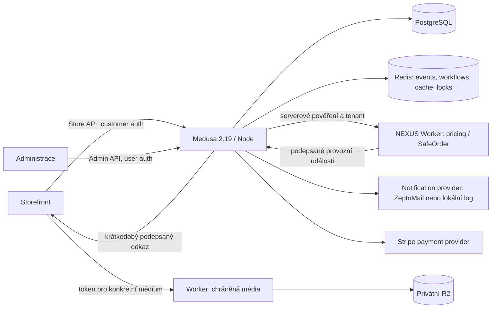

# ANASTASIA: technická dokumentace backendu

Datum: 15. 10. 2026. Zdrojový snapshot: `claude/backend-integration`,
`5066672b391a862077f38f99a182517b301a3f51`. Dokumentace popisuje implementaci tohoto snapshotu,
nikoli schválení produkčního provozu. Neobsahuje přístupové údaje ani skutečná zákazníková data.

## 1. Orientace a autorita dokumentů

Tento dokument slouží vývojáři, provozovateli a autorovi administrace. Vysvětluje hranice systému,
kritické obchodní toky, nastavení, diagnostiku a ověřování. Podrobná těla požadavků a doménová
pravidla jsou v odkazovaných dokumentech balíků; konkrétní validátor a route jsou konečnou autoritou.

- [Katalog vlastních API a modulů](API-KATALOG.md): všechny implementované route soubory a jejich HTTP metody.
- [Aktuální soupis pro implementaci administrace](wp/ADMIN-SOUPIS.md) včetně bezpečnostních změn a chybějících kontraktů.
- [Mapa funkcí pro administraci](wp/backend-admin-capabilities.md) a [strojový inventář](wp/backend-admin-inventory.json).
- [Nasazení a infrastruktura](DEPLOY.md), [lokální zálohování a obnova](wp/PRODUCTION_RUNBOOK.md).
- [Rozdělení backendové práce](wp/ROZDELENI-BACKEND-ZBYTEK.md).

Starší dokumenty jsou také historií jednotlivých balíků: jejich původní počty testů a poznámky
„zatím nezapojeno“ nejsou automaticky stavem dnešní integrační větve. Zejména původní
`wp/protected-media.md` popisuje Worker jako plán, ale aktuální Worker již obsahuje
[`mediaDelivery.ts`](../../nexus/workers/api/routes/mediaDelivery.ts). Stejně tak historické limity
v `NEXUS-INTEGRATION.md` nenahrazují pozdější implementaci kupónů, plateb a HTTP důkazy.

## 2. Architektura



Medusa běží jako Node aplikace, nikoli uvnitř Cloudflare Workeru. PostgreSQL uchovává katalog,
košíky, objednávky, platby a vlastní moduly. Redis při nastaveném `REDIS_URL` poskytuje společné
události, workflow engine, cache a zámky; bez něj konfigurace používá lokální paměťové varianty.
To není ověření bezpečného provozu více instancí. Chybějící Redis v produkci nynější konfigurace
jen hlásí varováním — provozní kontrola ho musí vyžadovat samostatně.

NEXUS má širší doménové jádro, ale zapojení ANASTASIA používá konkrétní pricing/SafeOrder adaptéry.
Existence jiné NEXUS domény neznamená, že je automaticky dostupná v tomto obchodě.
Jedna Medusa instance odpovídá jednomu obchodu; zákazníkové tabulky netvoří ověřenou sdílenou
víceobchodovou databázi. Worker váže tenant na serverové pověření, nikoli na vstup storefrontu.

### Adresáře a odpovědnosti

| Cesta | Úloha |
|---|---|
| [`../medusa-config.ts`](../medusa-config.ts) | Registrace modulů/providerů, runtime konfigurace, produkční kontroly. |
| [`../src/api`](../src/api) | Store/admin HTTP rozhraní a middleware. |
| [`../src/workflows/hooks.ts`](../src/workflows/hooks.ts) | Společné kontroly completion workflow. |
| [`../src/modules`](../src/modules) | Doménové služby, modely, migrace a policy. |
| [`../src/subscribers`](../src/subscribers) | Návaznosti na order/payment/chat/auth události. |
| [`../src/jobs`](../src/jobs) | Retence, údržba a dávkové notifikace. |
| [`../src/lib`](../src/lib) | Sdílené guardy, e-maily a pozorovatelnost. |
| [`../src/scripts`](../src/scripts) | Bootstrap, migrace katalogu/zákazník a pomocné nástroje. |
| [`../integration-tests/http`](../integration-tests/http) | Skutečné HTTP scénáře nad syntetickou Medusou/PG. |
| [`../../nexus/workers/api`](../../nexus/workers/api) | Edge API, média a přesměrování. |

## 3. Přihlášení, oprávnění a hranice důvěry

Store API používá publishable API klíč a tam, kde to endpoint vyžaduje, zákazníkom Medusa identitu.
Publishable klíč není důkaz přihlášení zákazník. Admin API vyžaduje identitu typu `user`;
zákazníkov token nesmí získat administrátorský přístup. Detailní role pro jednotlivé agendy
nejsou tímto dokumentem prohlášeny za implementované.

Provider [`auth-magic-link`](../src/modules/auth-magic-link/service.ts) ověřuje jednorázový token,
uchovává jeho hash a propojuje ověřenou identitu se zákazníkov. Importovaný účet se aktivuje
teprve po ověření. Duplicitní nebo cizí vazba není důvodem k výběru „prvního“ účtu.
Viz [auth dokumentace](wp/auth-magic-link.md); dnešní registrace provideru je v `medusa-config.ts`.

Vlastnictví košíků, objednávek, konverzací a přístupů ověřuje server. U některých vlastnických
kontrol cizí objekt vrací 404, aby se nerozlišovala jeho existence. Guest košík může mít nativně
vytvořené `customer_id`; to samo neznamená registrovaný účet ani zákazníkové přihlášení.
Erasure middleware navíc odmítá dříve vydané tokeny anonymizovaných účtů.

## 4. Objednávka od košíku po následné události

1. Storefront založí košík a mění jeho položky nativním Medusa API. Cenu ani zákazníkom úroveň neurčuje.
2. `POST /store/nexus-cart { cart_id }` přečte skutečný katalog, množství, region a skupiny zákazník,
   ověří cenu u Workeru a uloží snapshot do košíku. NEXUS ceny se nesmějí znovu zlevnit nativní promotion logikou.
3. Klient vybere dopravu z API. Platba se založí nativní payment collection/session cestou pro aktuální částku.
4. Klient načte `GET /store/legal/versions` a uloží souhlas přes `POST /store/carts/:id/consents`.
   Verze textů přicházejí ze serveru, nikoli z konstant storefrontu.
5. Dokončení může jít přes nativní `POST /store/carts/:id/complete` nebo přes
   `POST /store/nexus-checkout { cart_id }`. Obě cesty sdílejí workflow kontroly.
6. Server znovu kontroluje souhlas, pricing snapshot, částku/měnu platební relace, SafeOrder,
   rezervaci konzultace, dopravu, sklad a poukazové vazby podle příslušné implementace.
7. Nativní workflow vytvoří objednávku a rezervaci skladu. Subscribery provedou návaznosti.
   Přijetí objednávky a SafeOrder `ALLOW` nejsou důkazem capture platby.

Změna ceny vyžaduje novou odpovídající platební relaci; custom checkout vrací 409 místo dokončení
se starou částkou. `paymentStatus: PAID` vychází ze skutečného capture, jinak je `PENDING`.
Při výpadku SafeOrder nebo chybném tenant/amount/currency kontextu se objednávka nedokončí.
Testovací `pp_system_default` není skutečná platba a Worker jej dovoluje jen v test/development prostředí.
Podrobnosti: [integrovaný checkout](wp/integrated-checkout.md), [pricing kontrakt](../NEXUS-INTEGRATION.md).

### Doprava a sklad

Skladové množství poskytuje seznam/detail produktů s `fields=%2Bvariants.inventory_quantity`.
Server zohlední prodejní kanál a rezervace. Přidání do košíku samo zásobu nedrží; dokončení
rezervuje zásobu pod inventory zámkem. U spravovaných variant bez backorder nesmí vzniknout přeprodej.
Storno přes nativní workflow uvolní rezervaci. Nedostatek zásob vrací v této verzi API 400.

Doprava a podmíněné ceny jsou nativní záznamy v DB. Bootstrap může vytvořit nulovou cenu kurýra
s pravidlem `item_total >= hranice`. `item_total` zahrnuje DPH a slevy položek, nezahrnuje dopravu.
Env hranice je vstup při založení; opakovaný bootstrap již existující způsob nepřepisuje.
Seznam dopravy může obsahovat i metodu s jiným shipping profilem; přítomnost v seznamu není
důkaz použitelnosti. Completion kontroluje pokrytí profilů položek skutečně vybranými metodami.
Viz [sklad](wp/stock-availability.md), [doprava](wp/shipping-settings.md).

## 5. Domény a perzistence

| Oblast | Autoritativní data a chování | Detail |
|---|---|---|
| Katalog a ceny | Nativní produkty, varianty, ceny, kanály, regiony. Import uchovává legacy vazby; cena se ověřuje serverem. | [Import](wp/catalog-import.md) |
| Poukazy | `gift-voucher`: nastavení, vydaný poukaz a pohyby. Nastavení má snapshot na vydaném poukazu; peněžní deník není ops log. Vydání navazuje na platbu, uplatnění/vratky mají ochranu souběhu a opakování. | [Poukazy](wp/gift-voucher.md) |
| QR kupóny | Lokální SVG/PNG generátor, serverová validace kupónu a cenová pravidla. QR odkaz sám není uplatněná sleva. | [QR](wp/qr-redirects.md), [kupóny](wp/coupon-usage.md) |
| Rezervace | `booking`, týdenní `booking_availability`, serverové typy konzultací, hold/confirm/cancel a kolize kalendáře. | [Booking](wp/booking-availability.md) |
| Digitální nároky | `entitlement`: vlastník, produkt, zdroj a čas platnosti. Capture zpřístupňuje; storno/refund revokuje podle pravidel subscriberů. | [Ověření digitálního toku](wp/evidence/digital-checkout.json) |
| Chat | Konverzace, zprávy, blokace a stav notifikací. Jen text; zákazník 2000 znaků, správce 5000. Nezpůsobilost/blokace 403, uzavření 409, překročený limit 429. | [Chat](wp/chat.md) |
| Souhlasy | `legal_consent`: serverová verze a vazba cart/order. Bez platného souhlasu completion vrací 422. Newsletter má aktuální stav a oddělenou historii změn. | [Souhlasy](wp/legal-consents.md) |
| Odstoupení | `legal_withdrawal`: vlastní objednávka, lhůta, položky; received → accepted/rejected → refunded podle povolených přechodů. Stav refunded sám nespouští vrácení peněz. | [Legal](wp/legal-consents.md) |
| Soukromí | `customer_erasure`, `customer_note`: export vlastních dat, žádost a potvrzené provedení anonymizace, revokace přístupu. Interní poznámky nejsou ve store exportu. | [GDPR](wp/customer-gdpr.md) |
| Storno zákazníkov | Vlastní neodeslaná/nevyřízená objednávka bez zpřístupněného digitálního obsahu; booking lhůta; nativní storno a existující kompenzace. Vydaný bearer poukaz vyžaduje správce. | [Storno](wp/order-self-cancel.md) |
| E-mailové texty | `email_template_override`: přepisy textových slotů a enabled. Layout, odkazy a výpočty zůstávají v kódu; text se escapuje. | [E-maily](wp/c1-emails.md) |
| Provoz a audit | `ops_event`, `ops_audit_entry`; odděleně od peněžních transakcí poukazů. | [Mapa pokrytí](wp/backend-admin-capabilities.md) |

Export ani anonymizace nesmějí získat práva k e-mailově vázaným datům pouze podle editovatelného
profilového e-mailu; implementace používá ověřené auth identity. Export nevrací bearer kódy poukazů.
Účetní částky a potřebné záznamy objednávek zůstávají po anonymizaci zachované. Externí zálohy,
již doručené e-maily a zákonné retenční rozhodnutí vyžadují samostatný provozní postup.

## 6. Chráněná média

`POST /store/media-access` přijímá `{ product_id, media_key }`. Vyžaduje přihlášení, aktivní entitlement
a klíč v `product.metadata.protected_media`. Vrací krátkodobý podepsaný odkaz, expiraci a watermark;
nevrací přímou veřejnou R2 adresu. Pole registru může obsahovat `{ key, title }`.

Backend podepisuje HMAC-SHA256 token pro konkrétní zákazníci, produkt a objekt. Výchozí TTL je 600 s,
maximum 900 s. `MEDIA_DELIVERY_BASE_URL` musí odpovídat prefixu Workeru bez `/v1`, tedy
`https://<worker-host>/api/media`; backend sám přidá `/v1/<encoded-key>?t=…`.
Worker obsluhuje `GET/HEAD /api/media/v1/…`, kontroluje podpis/expiraci/klíč, podporuje Range
a přepisuje HLS playlisty pro povolené segmenty. Odpovědi mají `private, no-store`.

Worker je v tomto snapshotu implementovaný. Samotná implementace ani zpráva o nahrání souborů
nedokazují správné produkční nastavení bucketu, vazby produktů nebo klientského přehrávače.
Nejde o DRM. Limit souběžného přehrávání není v `mediaDelivery.ts` implementovaný; již vydaný token
se po revokaci entitlementu sám okamžitě nezneplatní, zůstává omezen svou expirací.

## 7. Nastavení: DB versus prostředí

Hodnoty tajemství patří do správy secrets hostingu. Dokumentace uvádí pouze jejich názvy.
Nikdy je nevystavovat ve storefrontu, logu ani formuláři běžných obchodních nastavení.

| Konfigurace | Autorita / chování |
|---|---|
| `DATABASE_URL`, `JWT_SECRET`, `COOKIE_SECRET` | Runtime Medusy. Production vyžaduje PostgreSQL, různé kvalitní secrety min. 32 znaků. |
| `STORE_CORS`, `ADMIN_CORS`, `AUTH_CORS` | V production přesné HTTPS originy; CORS nenahrazuje autentizaci. |
| `REDIS_URL` | Zapojí Redis moduly. Bez něj není doložen bezpečný provoz více instancí. |
| `NEXUS_PRICING_URL`, `NEXUS_PRICING_API_KEY`, `NEXUS_TENANT_ID` | Backend → Worker; odpovídá Worker `MEDUSA_PRICING_API_KEY`, `MEDUSA_PRICING_TENANT_ID`. |
| Worker `MEDUSA_PRICING_POLICY_JSON` | Tenantová cenová politika; žádný klientský přepínač tenantu nebo procent. |
| `STRIPE_API_KEY`, `STRIPE_WEBHOOK_SECRET`, `STRIPE_CAPTURE` | Provider `pp_stripe_stripe`, webhook `/hooks/payment/stripe_stripe`; capture výchozí true. Live klíč je mimo production odmítnut. Production nyní vyžaduje live klíč a webhook secret. |
| `S3_BUCKET`, `S3_FILE_URL`, `S3_ACCESS_KEY_ID`, `S3_SECRET_ACCESS_KEY`, `S3_REGION`, `S3_ENDPOINT` | Obecný Medusa file provider; bez úplné konfigurace lokální soubory. Není to automaticky privátní media delivery. |
| `MEDIA_TOKEN_SECRET`, `MEDIA_DELIVERY_BASE_URL` | Podepisování médií; secret min. 32 znaků musí odpovídat Workeru. |
| `ZEPTOMAIL_API_KEY`, `ZEPTOMAIL_FROM_EMAIL`, `ZEPTOMAIL_FROM_NAME`, `ZEPTOMAIL_REPLY_TO`, `ZEPTOMAIL_API_URL` | Při klíči e-mail provider ZeptoMail, jinak pouze `notification-log`; doména a skutečné doručení se ověřují zvlášť. |
| `MAGIC_LINK_BASE_URL`, `ACCOUNT_URL`, `ACCOUNT_ORDERS_URL`, `ACCOUNT_BOOKINGS_URL` | Cílové odkazy přihlášení a e-mailů; provozní domény určuje prostředí. |
| `LEGAL_TERMS_VERSION`, `LEGAL_PRIVACY_VERSION`, `NEWSLETTER_CONSENT_VERSION` | Serverové verze publikovaných textů, bez řádné konfigurace nelze předpokládat funkční sběr souhlasů. |
| `ORDER_SELF_CANCEL_BOOKING_HOURS` | Výchozí 24 hodin, povolené rozmezí 0–720; nejde o klientské nastavení. |
| `ANASTASIA_FREE_SHIPPING_FROM_EUR` | Vstup bootstrapu pro novou dopravu; prázdné = bez pravidla zdarma. Existující ceny mění správce v DB. |
| `GIFT_VOUCHER_DELIVERY` | Zapojení doručení poukazů; podrobnosti v dokumentaci poukazů. |
| `CHAT_ADMIN_NOTIFY_EMAIL`, `CHAT_ADMIN_URL`, `CHAT_STOREFRONT_URL` | Adresát a odkazy chat notifikací; obsah chatu nepatří do logu. |
| `CHAT_RETENTION_DAYS`, `OPS_EVENT_RETENTION_DAYS`, `OPS_AUDIT_RETENTION_DAYS` | Retence obsahu, provozních událostí a auditu; rozsahy a chování níže. |
| `OPS_INGEST_SECRET` | Podpis příchozích edge událostí; ingest dále ověřuje tenant kontext. |

Obchodní nastavení v PostgreSQL: produkty/ceny/DPH/sklady/doprava, skupiny zákazník a `metadata.nexus_tier`,
booking typy a dostupnost, poukazová nastavení, přepisy e-mailů. Chat limity a část SafeOrder policy jsou
zatím v kódu; neprezentovat je jako hotové admin nastavení. Kompletní přehled a detaily auditu poskytuje
[mapa schopností](wp/backend-admin-capabilities.md).

## 8. Události, kompenzace a opakování

`order.placed` navazuje souhlasy, poukazy, booking, nároky a potvrzení objednávky. `payment.captured`
potvrzuje placené doménové návaznosti; `order.canceled` a `payment.refunded` spouštějí příslušné
kompenzace. Storno zákazníkov znovu neimplementuje refundy. Částečné vratky a již zpřístupněné digitální
instrumenty mají doménová omezení a případnou ruční kontrolu.

Notifikace používají [`sendEmail`](../src/lib/email/send.ts), uložené textové přepisy a identifikátor
opakované události. Jednotlivé domény mají vlastní mechanismy deduplikace; nejde o obecný příslib
„exactly once“ pro každý externí systém. Výpadek po odeslání a před záznamem výsledku vyžaduje
diagnostiku, nikoli slepé opakování finanční operace nebo e-mailu.

| Job | Plán v kódu | Úloha |
|---|---|---|
| `gift-voucher-maintenance` | `17 * * * *` | Údržba poukazů a doručení podle služby. |
| `gift-voucher-rate-limit-cleanup` | `*/10 * * * *` | Úklid expirovaných záznamů limitu. |
| `chat-admin-digest` | `*/10 * * * *` | Dávková upozornění správci. |
| `chat-retention` | `*/10 * * * *` | Redakce obsahu uzavřených konverzací. |
| `legal-rate-cleanup`, `customer-privacy-token-cleanup` | `*/10 * * * *` | Úklid dočasných limitů a ověřovacích hashů. |
| `ops-retention` | `17 3 * * *` | Retence provozních událostí a admin auditu. |

Časové pásmo scheduleru ověřit při konfiguraci hostingu; cron zápis sám není důkazem slovenského času.

## 9. Logy a dohledání incidentu

[`request-id.ts`](../src/lib/observability/request-id.ts) vrací `x-request-id` a zavádí kontext požadavku.
[`log.ts`](../src/lib/observability/log.ts) vytváří strukturované JSON události s `ts`, `level`, `domain`,
`event`, `request_id` a redigovanými poli. Interní ID jsou pseudonymní údaje, nikoli anonymní data.
Tokeny, adresáti, kódy a obsah zpráv nesmějí být v diagnostických přílohách.

`recordEvent` zapisuje také do `ops_event`. `GET /admin/ops/events` umožňuje filtry `request_id`,
`order_id`, `cart_id`, `customer_id`, `entity_id`, `domain`, `level`, `event`, `from`, `to`, `limit`, `offset`.
Admin audit `/admin/ops/audit` filtruje `entity_type`, `entity_id`, `actor_id`, `action`.
Obě rozhraní jsou administrátorská; nejde o veřejný zákazníkov přehled.
Edge dávky přijímá podepsaný `POST /hooks/ops/edge-events` s timestampem a podpisem, nikoli s customer JWT.

Postup při incidentu:

1. Uložit čas, prostředí, revision a `x-request-id`; získat cart/order ID bez kopírování tokenů.
2. V ops events propojit pricing → SafeOrder → checkout → payment → subscriber/notification.
3. Porovnat skutečný stav objednávky, platby, rezervace a deníku poukazu. Návrat prohlížeče není důkaz capture.
4. Pokud chybí trvalá událost, zkontrolovat chráněný stdout log a `ops_event_write_failed`.
5. Externí finanční výsledek nejprve ověřit u poskytovatele schválenou cestou; neopakovat naslepo.

Zápis provozního logu/auditu může selhat po úspěšné obchodní změně; není všude součástí jediné DB transakce.
Ne každý nativní Medusa či historický logger prochází redaktorem. Neexistuje doložené kompletní zachycení
každého přístupu, metrik, alertů a auditování čtení; přesné pokrytí je v mapě schopností.

Retence: ops events výchozí 90 dnů (7–730), audit 1095 dnů (365–3650); nejvýše 10 000 řádků na běh.
Chat výchozí 365 dnů (30–3650); redakce starého uzavřeného obsahu zachová ID a časové vazby.
Neplatná chat konfigurace mazání zastaví. Finanční deník poukazů není součástí ops retence.

## 10. Vývoj a bezpečné ověřování

Požadované verze vycházejí z [`package.json`](../package.json): Medusa 2.19.0, Node
`^20.19.0 || >=22.12.0`, npm 11.9.0. Závislosti instalovat z lockfile. Pro místní vývoj
slouží `npm run dev`, pro build `npm run build`; prostředí a DB musí být předem schválené.

Typová kontrola z kořene repozitáře:

```sh
cd backend
npx tsc --noEmit
```

Plnou regresi spouští [GitHub Actions workflow](../../.github/workflows/wave1-p0.yml).
Job `verify` ověřuje NEXUS/workerd; navazující `medusa-persistence` provádí backend unit, tsc
a `verify-safeorder-local.py` se syntetickým PostgreSQL a skutečnými HTTP požadavky bez externí sítě.
Artefakty obsahují revision, runtime, `backend-unit.json`, `medusa-test.log` a při úspěšném dokončení
evidence scénářů. Běžná retence artefaktů je 14 dní; důležité syntetické důkazy zachovat v repozitáři.

V této etapě platí dohoda: plné testy jen Actions, žádné souběžné lokální PG/HTTP běhy s druhým agentem.
Samotný unit mock nedokazuje rezervaci zásoby, izolaci účtů nebo platbu přes reálného poskytovatele.
Testy používají vlastní produkty, aby booking/digitální nastavení nekontaminovalo jiné skupiny.

### Stav důkazů při sestavení dokumentace

| Revision / běh | Doložený výsledek | Hranice |
|---|---|---|
| `4ba87ff`, [38667772955](https://github.com/hlancaric-ship-it/anastasia-nexus/actions/runs/38667772955) | Backend 516/516, celý HTTP včetně X1–X3 PASS. | Starší základ před C-2/C-3. |
| `9e2f145`, [38674567783](https://github.com/hlancaric-ship-it/anastasia-nexus/actions/runs/38674567783) | Backend 518/518, NEXUS 1179/1179, workerd 42/42; skladových 6 scénářů dokončeno. | Celý HTTP FAIL na následném testu seznamu dopravy. |
| `5066672`, [38675189204](https://github.com/hlancaric-ship-it/anastasia-nexus/actions/runs/38675189204) | Oba joby PASS; backend 518/518, NEXUS 1179/1179, workerd 42/42 a celý HTTP PASS. Všech 6 skladových a 5 dopravních scénářů PASS. | Syntetické prostředí; neověřuje produkční doručení, platbu ani nasazení. |

Poslední výsledek byl ověřen čtením stažených artefaktů, nikoli jen barvou CI. Stručný trvalý
[záznam výsledku](wp/evidence/backend-ci-2026-10-15.json) zachovává zdrojovou revision a C-3 scénáře.

## 11. Nasazení, obnova a otevřené podmínky

Tato příručka nic nenasazuje. Před případným nasazením je potřeba samostatné schválení a konkrétní
prostředí: hosting Node/PG/Redis, HTTPS/proxy, secrets, privátní média, zálohy, alerty a odpovědný provozovatel.
Migrace jsou v jednotlivých modulech; pořadí a aplikaci řídí Medusa. Změny schématu nelze nahradit
samotným spuštěním aplikace. Bootstrap není import úplného katalogu ani trvalá synchronizace všech nastavení.

Lokální `backup-local.mjs` a `restore-local.mjs` mají dry-run a výslovné potvrzení zápisu;
obnova vyžaduje prázdný schválený lokální cíl. Záloha se nesmí commitovat. Produkční PITR,
šifrovaná off-site kopie, ověřený restore drill a RPO/RTO nejsou zajištěny existencí těchto skriptů.
Postupy jsou v [runbooku](wp/PRODUCTION_RUNBOOK.md).

Před akceptací provozu zbývá doložit skutečnou Stripe test platbu/webhook, živé doručení e-mailu
z ověřené domény, vlastnictví a konfiguraci R2 u klientky, přiřazení chráněných médií po importu,
schválené dopravce/ceny a daňový/účetní režim. Produkční monitoring a odpovědnost za obnovu musí
mít vlastníka. Existující synthetic CI tyto externí podmínky nepotvrzuje.

## 12. Údržba dokumentace

Při změně endpointu aktualizovat katalog API a dokument konkrétní domény. Při změně policy/env
uvést, zda jde o DB nastavení, vstup bootstrapu nebo restart/deployment konfiguraci. Při opravě
uvést přesný ověřený commit a běh; nepřenášet zelený výsledek automaticky na pozdější kód.
Před rozšířením admin UI kontrolovat skutečné backendové oprávnění, audit a chybové stavy.
